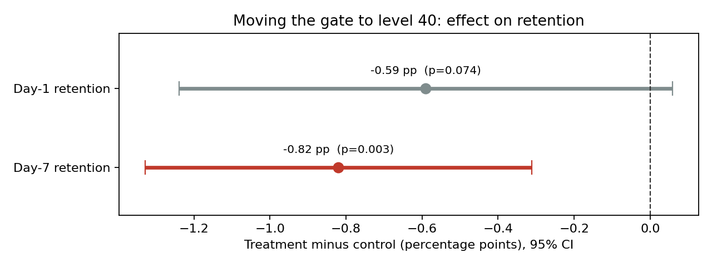
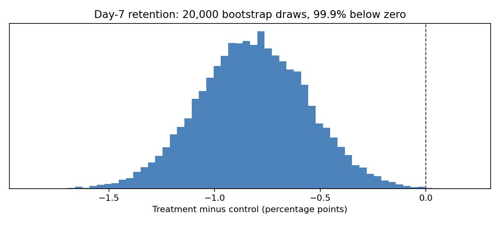

# A/B Test Readout: Cookie Cats Gate Experiment

[](https://github.com/SylviaZam/ab-test-readout/actions/workflows/tests.yml)

This is a reusable pipeline that takes a user-level A/B test export and produces a decision. It checks the data first, then tests each metric, then writes an Excel readout and charts that a product team can act on. It is shown here on a public mobile-game experiment with 90,189 players.

## The experiment

In Cookie Cats, a puzzle game, players hit a "gate" that makes them wait or pay before continuing. The test moved the first gate from level 30 (control, `gate_30`) to level 40 (treatment, `gate_40`). The test tracked whether each player came back 1 day and 7 days after installing.

## Result

**Recommendation: keep the gate at level 30.** Moving it to level 40 lowered 7-day retention by 0.82 percentage points, with a 95% confidence interval of -1.33 to -0.31. Adjusted for testing two metrics, p = 0.003. 1-day retention also dipped (-0.59 pp), but that difference is within noise (p = 0.074).



| Metric | Level 30 | Level 40 | Difference | 95% CI | p (Holm) | Smallest detectable effect* |
|---|---|---|---|---|---|---|
| Day-1 retention | 44.82% | 44.23% | -0.59 pp | -1.24 to +0.06 | 0.074 | 0.93 pp |
| Day-7 retention | 19.02% | 18.20% | **-0.82 pp** | -1.33 to -0.31 | **0.003** | 0.73 pp |

\*At 80% power and α = 0.05 with these sample sizes. The Day-7 drop is larger than the smallest effect this test could reliably detect. The Day-1 dip is smaller, so a real but small Day-1 effect can't be ruled out.

A bootstrap with 20,000 resamples puts 99.9% of the Day-7 differences below zero:



Rounds played, a secondary metric, are heavily skewed (median 16-17, maximum 49,854). Medians are nearly identical between the two groups (Mann-Whitney p = 0.05), so the retention drop is not explained by a collapse in play.

## Checks run before reading any result

| Check | Finding | Status |
|---|---|---|
| Sample ratio mismatch | 44,700 vs 45,489 players (50.4% in treatment); chi-square p = 0.009 against a 50/50 plan | **Warning** |
| Duplicate users | 0 | OK |
| Missing outcomes | 0 | OK |
| Extreme values | 1 player with 49,854 rounds (more than 40x the 99.9th percentile) | Note: affects engagement only |
| Never played | 4.4% of players | Kept in (intent-to-treat) |

**The sample-ratio warning matters.** A 50/50 assignment should not miss by this much by chance. The usual causes are an assignment bug or uneven logging between groups. The dataset doesn't reveal which, so the readout states it as a caveat on the decision. On a real team, this would go to engineering before anything ships.

Every retention rate is also recomputed in SQL straight from the raw CSV ([`sql/variant_metrics.sql`](sql/variant_metrics.sql), run in DuckDB) and matched against the Python numbers. All 4 match.

## Method

- **Primary test:** a two-sided two-proportion z-test with pooled standard error, plus a 95% Wald interval on the difference. Wald intervals are fine at about 45,000 users per arm.
- **Two metrics, one decision:** p-values are Holm-adjusted, so testing two metrics doesn't inflate false positives.
- **Effect size and power:** Cohen's h, observed power, and the minimum detectable effect at 80% power.
- **Bootstrap:** 20,000 resamples per arm. For a 0/1 outcome, resampling users is exactly a binomial draw, so the bootstrap is fast and exact.
- **Intent-to-treat:** every assigned player counts, including the 4.4% who never played and so never reached either gate. Including them dilutes the effect toward zero, which makes the result conservative.
- **What the analysis deliberately avoids:** splitting players by rounds played. Rounds happen after assignment, so they are partly an outcome of the gate, and comparing groups within rounds-played bands would bias the result. The [2025 first-pass notebook](notebooks/2025_first_pass.ipynb) made that mistake; the pipeline drops it.

## Limitations

- **The data shows that retention dropped, not why.** One hypothesis is that an earlier forced break keeps players wanting more, but this test can't confirm it.
- **The sample-ratio mismatch is unexplained** (see above).
- **Retention is measured once per player**, with no pre-test history, so variance-reduction methods like CUPED aren't possible here.
- **The data is from one game and one time period.** The effect may not hold elsewhere.

## Run it

```bash
python -m venv .venv && source .venv/bin/activate
pip install -r requirements.txt

python -m src.ab_cli                      # Cookie Cats, writes reports/ and assets/
```

It works on any one-row-per-user export with 0/1 outcomes:

```bash
python -m src.ab_cli --data my_test.csv --unit user_id --variant arm \
  --control A --treatment B --metrics converted,retained_d7 --engagement none
```

The run stops with exit code 1 if a check fails outright, such as duplicate users or unexpected variant names.

**Tests:** 16 tests check each formula against statsmodels and SciPy, confirm a known effect is detected and a null effect is not, and run the full command line. Run them with `pip install pytest && python -m pytest -q`.

## Outputs

| File | Contents |
|---|---|
| `reports/ab_readout.xlsx` | Sheets: Readout (the decision in one sentence), Results, Checks, Engagement, SQL_crosscheck |
| `assets/effect_ci.png`, `assets/bootstrap.png` | The charts above |

## Repository layout

```
data/cookie_cats.csv        public dataset (90,189 players)
src/stats.py                z-test, CI, Cohen's h, power, MDE, SRM, Holm, bootstrap
src/analysis.py             loading, data checks, per-metric results, decision text
src/sql_check.py            runs sql/variant_metrics.sql in DuckDB and compares
src/report.py               Excel readout and charts
src/ab_cli.py               command-line entry point
tests/                      pytest suite (runs on every push)
notebooks/2025_first_pass.ipynb   original exploration, kept for reference
```

Data: the public Cookie Cats A/B test dataset, as distributed for teaching. Built by [Sylvia Zamora](https://sylviazamora.com).
